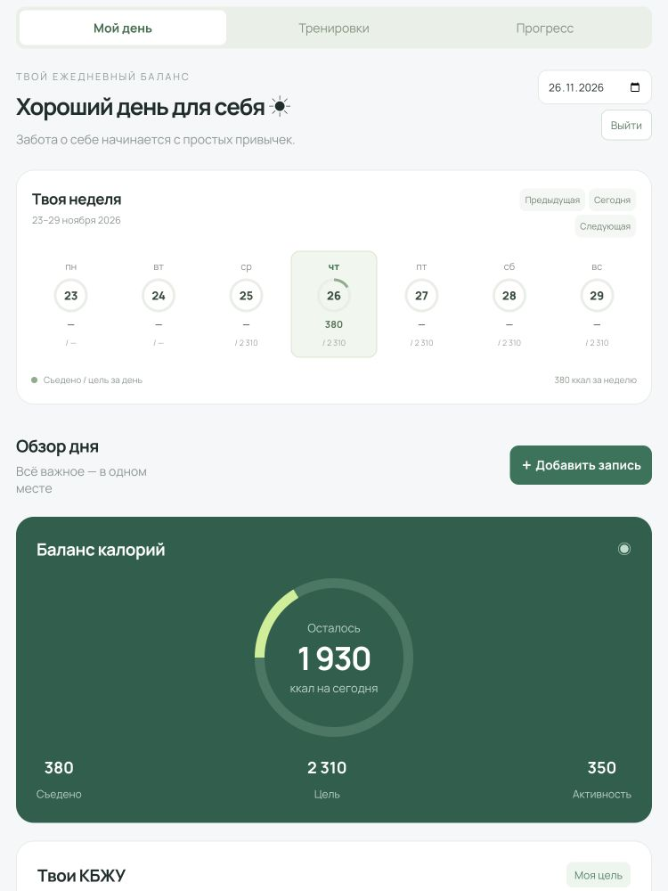
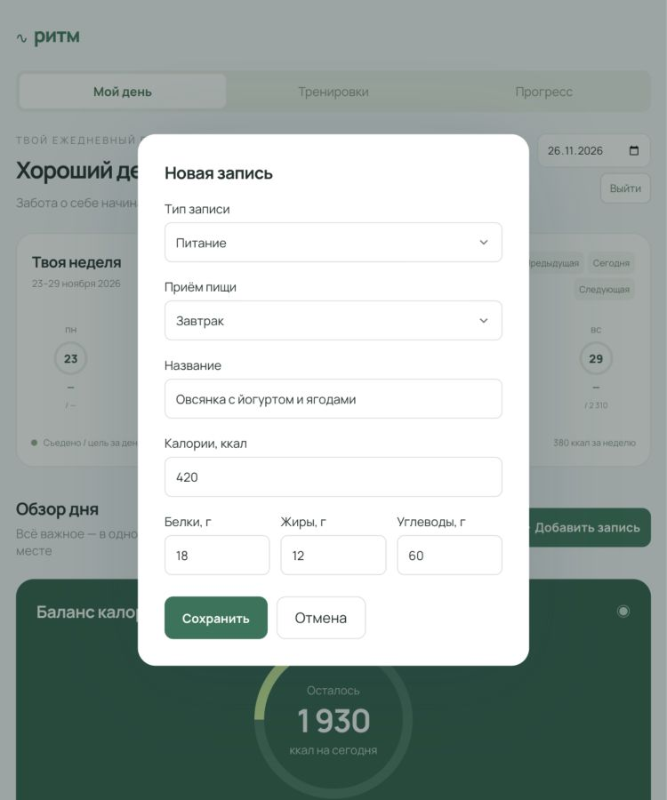
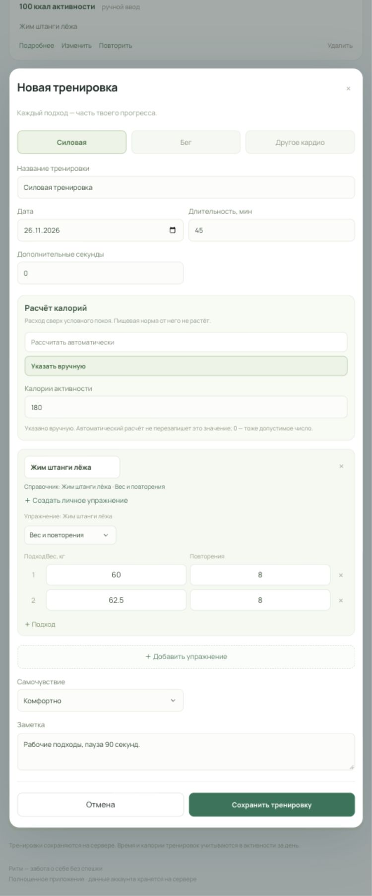
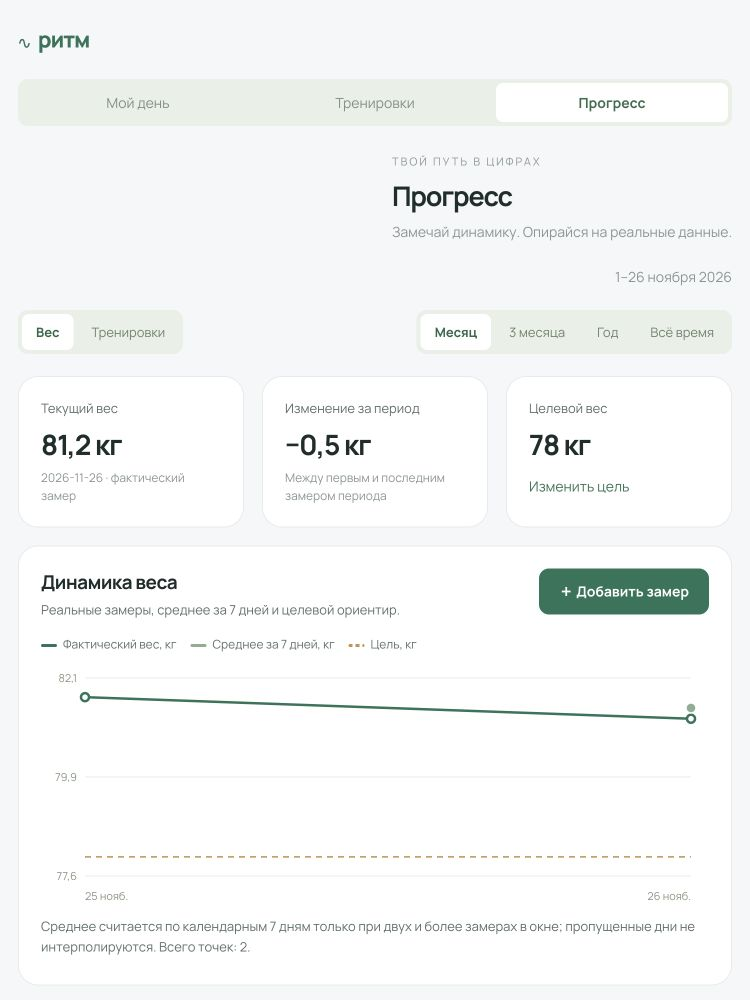
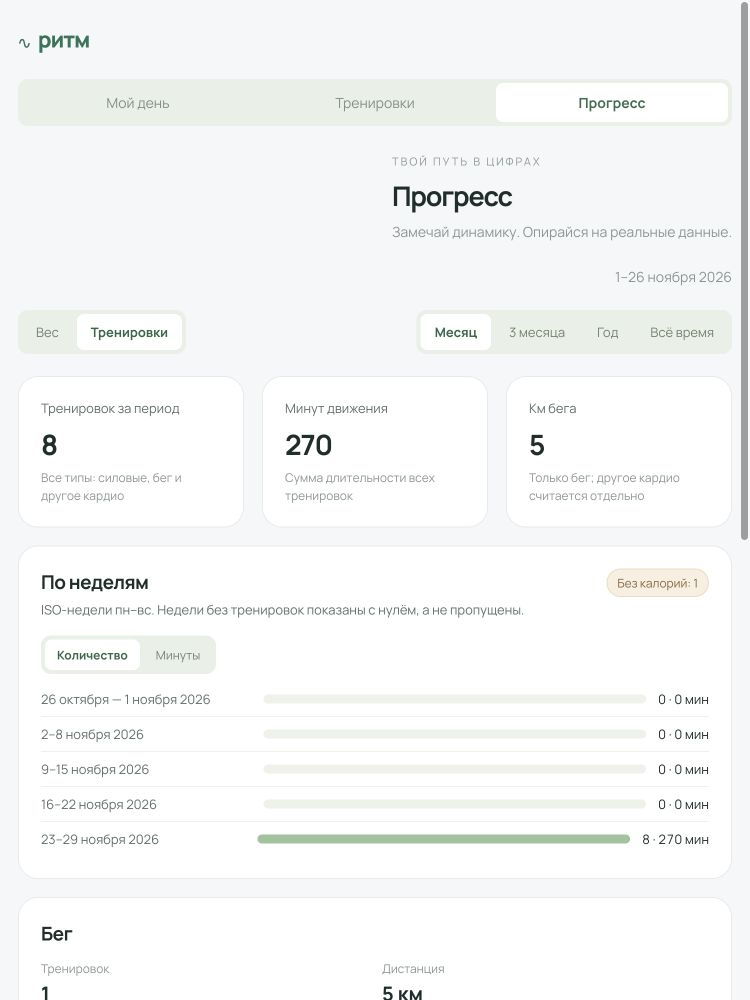

# Ритм

**Ритм** — персональный веб-трекер питания, тренировок и веса: дневной баланс
калорий, КБЖУ, еда, вода, активность, дневник тренировок и прогресс.

Это полноценный клиент-серверный сервис: аккаунт, анкета и записи хранятся на
сервере, а не в браузере. Интерфейс на русском, адаптирован для десктопа,
планшета и телефона.

## Интерфейс



Главный экран: день и неделя в одном месте.

### Заполнение питания



Завтрак, название, калории и БЖУ.

### Заполнение тренировки



Тип, длительность, упражнение из справочника, два подхода с весом и повторениями, заметка.

<details>
<summary>Ещё два экрана: прогресс по весу и тренировкам</summary>

<table>
  <tr>
    <td></td>
    <td></td>
  </tr>
  <tr>
    <td>Вес: замеры, цель и среднее за 7 дней</td>
    <td>Тренировки: количество, минуты и километры по неделям</td>
  </tr>
</table>

</details>

> Числа и записи на скриншотах вымышлены и служат только демонстрацией интерфейса.

## Возможности

- **Аккаунт и сессия.** Регистрация, вход и выход; серверная сессия в
  HttpOnly-cookie, изоляция данных разных пользователей.
- **Анкета и цель.** Вес, рост, дата рождения, процент жира, пол и уровень
  активности; цели «похудение» и «набор массы»; расчёт КБЖУ и история целей.
- **День и неделя.** Баланс калорий, неделя пн–вс с прогрессом по дням,
  переход по датам, дневник питания и вода.
- **Питание.** Четыре группы — завтрак, обед, ужин, перекусы; итоги по каждой
  группе, перенос записи между группами, общий счётчик калорий и БЖУ.
- **Вода и активность.** Восемь стаканов по 250 мл (цель 2 л), ориентир
  10 000 шагов, минуты движения и километры; записи добавляются вручную.
- **Тренировки.** Силовые, бег и другое кардио; 38 упражнений и личные;
  подходы, повторения, время, дистанция, пульс, уклон, заметки и самочувствие.
- **Калории тренировок.** Автоматический расчёт по MET или ручное значение;
  активный и общий расход показываются отдельно.
- **Вес и прогресс.** Журнал и целевой вес, среднее за 7 дней; недельные
  количество/минуты, километры бега, графики и история упражнений.
- **Доступность и адаптивность.** Клавиатура, подписи полей, фокус и узкие экраны.

## Стек

- **Frontend:** React 19, TypeScript, Vite 7, Tailwind CSS 4, компоненты в стиле
  shadcn/ui, React Router, TanStack Query, react-hook-form + zod, Zustand.
- **Backend:** PHP 8.2, Laravel 12, Apiato 13 (Porto), MySQL 8, Sanctum и CSRF.
- **Инфраструктура:** Docker Compose v2, nginx, PHP-FPM; frontend
  собирается в образ `web`.

## Быстрый запуск

Нужен только Docker с Compose v2. PHP, Composer и Node на хосте не требуются.

### 1. Окружение

```bash
cp .env.example .env
openssl rand -base64 32
```

Полученную строку добавьте в `.env` с префиксом `base64:`:

```dotenv
APP_KEY=base64:...
```

Приложение требует заполненный `APP_KEY` ещё до старта: без него контейнер
`backend` завершится с понятной ошибкой.

Задайте собственные `MYSQL_PASSWORD` и `MYSQL_ROOT_PASSWORD` вместо
значений-заглушек. `APP_URL` и `FRONTEND_URL` по умолчанию — `http://localhost:8080`,
`API_URL` — `http://localhost` без порта; при смене `WEB_PORT` обновите URL и
`SANCTUM_STATEFUL_DOMAINS`.

### 2. Сборка и миграции

```bash
docker compose up -d --build
docker compose exec -u www-data backend php artisan migrate --force
```

Откройте [http://localhost:8080](http://localhost:8080) и зарегистрируйтесь.

Код backend запечён в образ. После изменений пересоберите его:
`docker compose up -d --build`. `docker compose down` сохраняет именованные тома
с БД и storage, поэтому данные остаются на месте. Файл `.env` не коммитится —
в репозитории только `.env.example` со значениями-заглушками.

## Тесты

### Backend

Тесты должны работать с отдельной БД, а не с рабочей `ritm`. Полагаться на
неявное переопределение `DB_DATABASE` рискованно, поэтому переменные задаются явно:

```bash
docker compose exec -u www-data \
  -e APP_ENV=testing \
  -e DB_DATABASE=ritm_test \
  -e QUEUE_CONNECTION=sync \
  -e CACHE_STORE=array \
  -e SESSION_DRIVER=array \
  -e MAIL_MAILER=array \
  backend php artisan test
```

БД `${MYSQL_DATABASE}_test` создаётся скриптом в `docker/mysql/init` при
первой инициализации тома MySQL. Если том старый и тестовой БД нет, создайте
её один раз:

```bash
docker compose exec mysql bash /docker-entrypoint-initdb.d/01-create-test-database.sh
```

При своём `MYSQL_DATABASE` замените `ritm_test` на `<имя>_test`.

### Frontend

```bash
cd frontend
npm ci
npm test
npm run typecheck
npm run build
```

Нужен Node.js 22.12+ или 24 (требование Vite 7). Эти команды выполняются на
хосте; для Docker-запуска приложения Node не нужен.

## Структура

- [backend/](backend/) — PHP 8.2 + Apiato/Laravel: API, Porto-контейнеры,
  миграции и тесты.
- [frontend/](frontend/) — React + TypeScript SPA: экраны, компоненты и тесты.
- [docker/](docker/) — образы PHP-FPM и nginx, конфиги и init-скрипты MySQL.
- [docs/images/](docs/images/) — скриншоты для README.
- [docker-compose.yml](docker-compose.yml) — сервисы `mysql`, `backend`, `web`.
- [.env.example](.env.example) — шаблон окружения.

## Расчёты и данные

- **КБЖУ.** BMR по формуле Миффлина — Сан Жеора, TDEE с коэффициентом
  активности 1.2–1.725, затем −15% для похудения или +10% для набора.
  Калории округляются до 10 ккал.
- **БЖУ.** Белки — 1.6 г/кг либо 2 г/кг безжировой массы, если указан процент
  жира; жиры — 25% калорий; углеводы — остаток. Если норма ниже 1200 ккал или
  углеводы отрицательны, возвращается понятная ошибка.
- **Тренировки.** Автоматический расход:
  `active = round((MET − 1) × вес × часы)`, общий расход считается отдельно.
  MET берётся из фиксированного справочника Compendium 2024; ручной режим
  сохраняет введённое значение.
- **Активность.** Калории тренировок не увеличивают пищевую цель, а
  тренировки не добавляют шаги к ручным. В дневной активности учитываются оба
  источника, но без дублей.
- **Вес.** Среднее за 7 дней считается только при двух и более реальных
  замерах; пропущенные дни не интерполируются. Целевой вес не пересчитывает
  КБЖУ.
- **Даты.** Дневные границы и «сегодня» определяются по IANA timezone
  профиля. Изменение цели применяется к текущему и будущим дням, прошлые
  цели и записи не переписываются.

Автоматический MET-расчёт не учитывает уклон, пульс и самочувствие и
поддерживает не все виды кардио; для таких случаев доступен ручной ввод.
Поиска продуктов, распознавания еды и синхронизации с трекерами нет.
